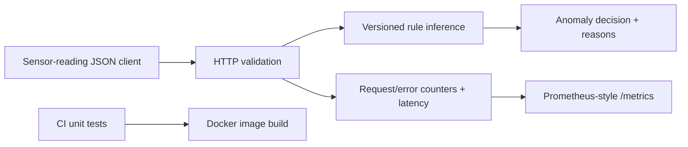

# Serving platform architecture

## Implemented
Stateless synchronous inference-style HTTP endpoint with input bounds checking, explicit reasons, versioned heuristic logic, structured request logging and basic metrics. Python standard library only.

## Production extension (not deployed)
- Register model artifacts and signed versions, deploy behind a managed load balancer.
- Deploy container to AWS ECS/Fargate or Kubernetes with secrets and least-privilege roles.
- Export OpenTelemetry traces, add health probes, dashboards and alerting.
- Use staging/production promotion, rollback and drift monitoring.
- Train and validate a real ML model before calling predictions machine-learning inference.

## Limitations
The current detection engine is rule-based, not a trained model. No authentication, request rate limiting, high-availability deployment or cloud deployment exists yet.
